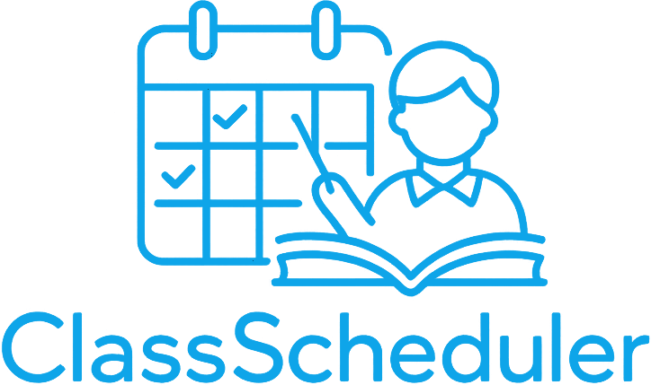

    

<h1>Class Scheduler - Backend</h1>

A RESTful API built with Laravel to manage students, class schedules, and students' progress.

This project is part of Class Scheduler, a web application designed to help teachers organize their students and manage their weekly classes.

Some features Class Scheduler includes:
- Schedule classes.
- Administrate students.
- Register course content.
- Keep track of each student's progress.
- Download full list of students in an Excel file.
- And more...

<h2>Laravel Features</h2>

Some features this RESTful API includes:
- Authentication with Laravel Sanctum.
- Laravel Requests for centralized request validation.
- API Resources to expose only the necessary information.
- Excel Exports.
- Database Migrations.
- Database Seeders.
- Eloquent ORM.

<h2>Try The Demo</h2>
You can visit the demo version in the following link:
 

    <a href="https://diegomysite.com/class-scheduler-demo/login" target="_blank">
        Class Scheduler - Demo.      
    </a>

You will need the following credentials:
 
<b>Demo user:</b> demo-user@class-scheduler.com 
 
<b>Password:</b> Cl4ss$chedul3r

<h2>About The Developer</h2>
You can learn more about me visiting my web site: 
<a href="https://diegomysite.com" target="_blank">diegomysite.com</a>

## License

Class Scheduler is open-sourced software licensed under the [MIT license](https://opensource.org/licenses/MIT).
